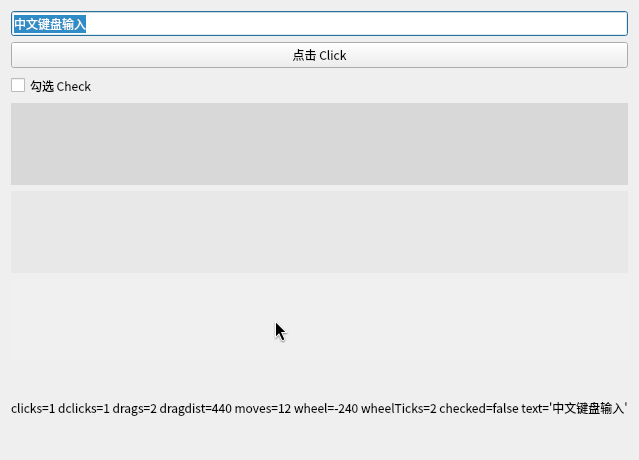
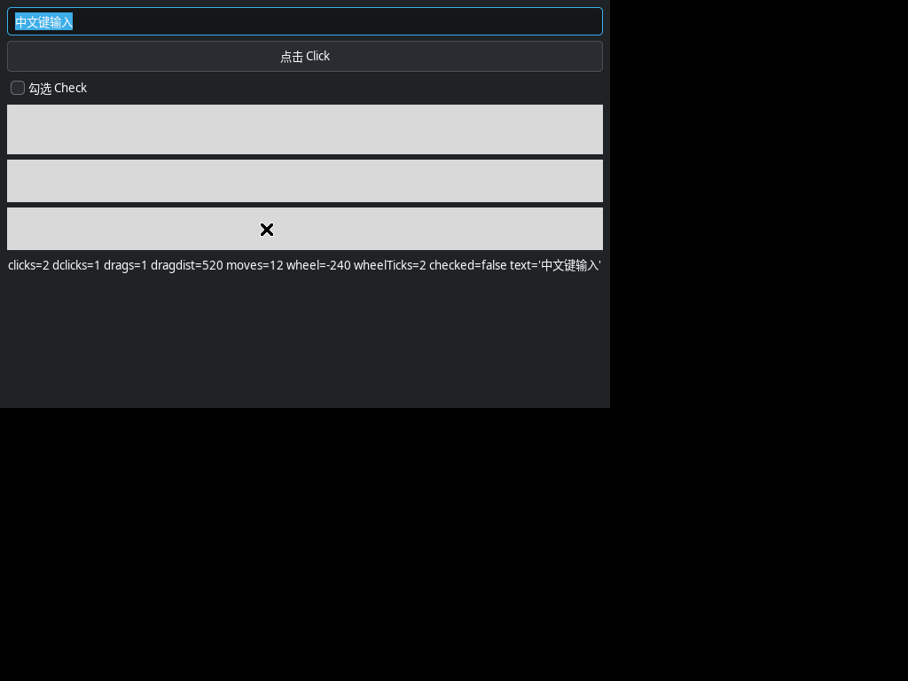
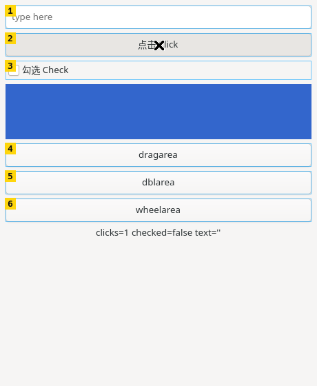
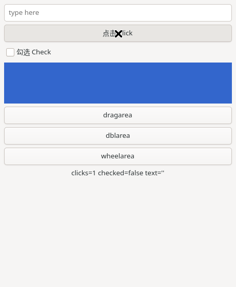
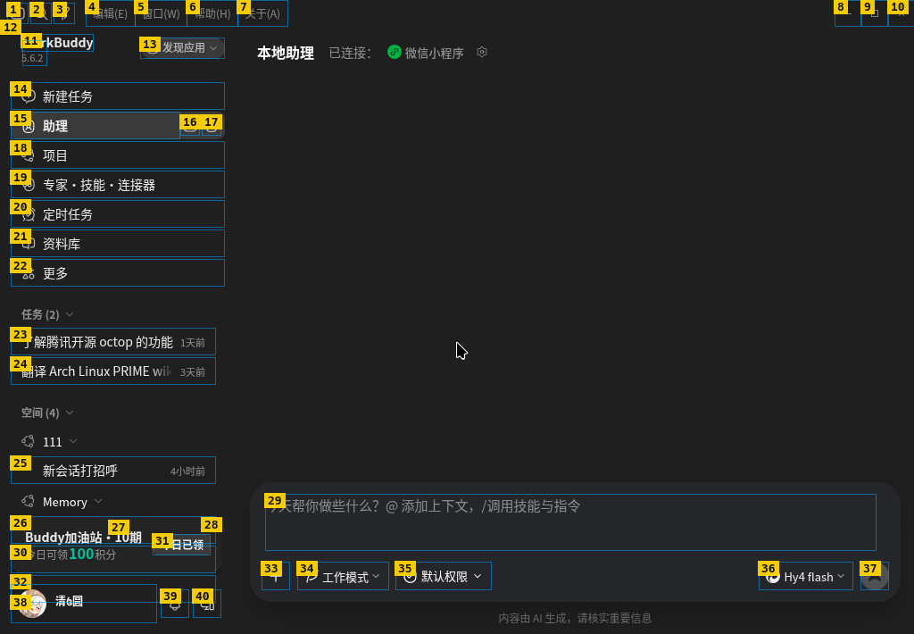

# dsh-ui-automation — numbered-image UI control for DeepSeek Harness

**Linux only.** The plugin drives an X11 display through XTEST and reads the screen through
AT-SPI2. macOS and Windows are not supported.

The agent never addresses a control by name, role or coordinate. It takes a **numbered
screenshot**: every actionable element gets a yellow badge (`1..N`), a thin outline, and an entry
in a sidecar JSON. The agent then says “click 4”. Every action clicks the centre of rectangle 4
with XTEST, waits `afterSeconds`, captures a **new** numbered image, and returns it. Indices from
the previous image are dead the moment the next image exists.



## Why numbered images

- **One contract.** “Number = pixel.” No semantic tree API to reconcile with a coordinate
  fallback, no toolkit-specific action names — a click is always an XTEST click at the centre of
  the numbered rectangle.
- **Inspectable.** The model (or a human reviewing the session) can `read_image` the exact frame
  that produced the indices. A stale numbering is visible, not hidden.
- **Works where accessibility is thin.** The numbering filter picks actionable roles/actions; if
  the tree is poor the model still sees the screenshot and can fall back to reading it.
- **Bounded by construction.** The screenshot is cropped to the windows, indices are capped, and
  old images are pruned; a session cannot accumulate an unbounded index space.

## What it is / is not

- **It is** a screen-level driver: point it at a display (an Xvfb used by your tests, or a real
  desktop) and drive it by number.
- **It is not** a launcher or a sandbox. There is no `ui_launch`: the test/app owner starts the
  application and gives the plugin a `display`. The plugin only screenshots and clicks.
- **It is not** a remote-desktop protocol. It uses the local X server and AT-SPI.
- **It is not** OCR: rectangles and labels come from the accessibility tree. Text the tree does
  not expose still appears in the screenshot, but is not numbered.

## Tools

| Tool | Parameters | Returns |
|---|---|---|
| `ui_screenshot` | — | `imagePath`, `imageId`, `display`, `screen`, `crop`, `targets[]` |
| `ui_click` | `index`, `button?`, `afterSeconds?` | action details + next numbered image |
| `ui_double_click` | `index`, `intervalMs?`, `afterSeconds?` | action details + next numbered image |
| `ui_scroll` | `index`, `direction` (`up/down/left/right`), `amount?`, `afterSeconds?` | action details + next numbered image |
| `ui_drag` | `fromIndex`, `toIndex`, `steps?`, `afterSeconds?` | action details + next numbered image |
| `ui_type` | `text?` or `keys?`, `index?`, `afterSeconds?` | typed/readback details + next numbered image |

`index` is 1-based and only valid for the most recent numbered image. Out-of-range indices return
a structured `E_INDEX`; an action before any screenshot returns `E_NO_IMAGE`.

`afterSeconds` defaults to the plugin setting (1.0 s) and is clamped to 0–30 s. The wait happens
**before** the new screenshot, so apps that repaint late are still captured.

`ui_type` with `index` targets that element: the AT-SPI path writes its text directly
(`EditableText.SetTextContents`, reliable for CJK); when the node has no `EditableText` the tool
clicks the recorded centre to focus it, types with XTEST, and reads the text back to verify.
`keys` (`ctrl+a`, `Return`, …) clicks the index to focus (when given) and always uses XTEST.

## How the numbering pipeline works

1. Capture the display size with `xdpyinfo`.
2. Walk every AT-SPI application on the session bus.
3. Keep interactive roles/actions (plus named drag surfaces), drop layout wrappers, exact
   duplicates, and regions that contain other candidates.
4. Sort by reading order: cluster elements into vertical bands by their centre, then
   left-to-right.
5. Crop the image to the union of the contributing windows (plus `padding`), so no black desktop
   surrounds the screenshot.
6. `ffmpeg -f x11grab` grabs the crop and draws thin outlines + yellow badges with
   `drawtext` (`/usr/share/fonts/TTF/Hack-Bold.ttf`). No PIL, no Qt overlay.
7. Write `<imageId>.png` and `<imageId>.json` (index → role/name/rect/centre/app pid/AT-SPI path,
   plus screen/crop metadata).

### GTK4 and the X11-origin fallback

GTK 4.24's AT-SPI bridge hardcodes every `SCREEN` origin to `(0, 0)` while `WINDOW` rectangles stay
correct ([full investigation](docs/GTK4-GEOMETRY.md)). The plugin detects that shape **per
application** — one `SCREEN` origin, several `WINDOW` origins — and rebuilds each rectangle as

```
X11 toplevel content origin + GetExtents(WINDOW)
```

using `xdotool search --pid` + `xwininfo`/`xprop` (including `_GTK_FRAME_EXTENTS` when the toolkit
advertises it). A GTK4 surface is one X11 toplevel, so dialogs and popovers are matched and shifted
independently. GTK3/Qt report real `SCREEN` origins, so they never enter this path.

Failure is never silent: if no X11 window can be matched, that application's targets are **dropped**
with a structured warning (`E_NO_X11_UTILS`, `E_NO_X11_WINDOW`, `E_NO_X11_ORIGIN`) and
`geometryTrusted: false`. A GTK4 target is therefore never numbered at `(0,0)` and never clicked
into the top-left corner. `gtk4OriginFallback=false` turns the repair off and drops the app the same
way. After the per-app pass a global guard still refuses a capture whose remaining targets all
share one origin.

## Screenshots

| Qt 6 fixture | GTK 3 fixture |
|---|---|
|  |  |

| GTK 4 (X11-origin fallback) | GTK 4 with the fallback disabled |
|---|---|
|  |  |

| WorkBuddy (Electron, real app) |
|---|
|  |

Each fixture shows its own counter line (`clicks=… dclicks=… drags=… wheel=… text='…'`); the
values match the state read back over AT-SPI after each numbered action. The GTK 4 capture uses
the X11-origin fallback; the second image is what the guard produces when the fallback is disabled
(`E_NO_GEOMETRY`, app dropped, no badges).

## Install

### Requirements

| Dependency | Why |
|---|---|
| an X11 `DISPLAY` | the plugin operates on a display you provide; it does not start one |
| `at-spi2-core` | accessibility registry the numbering helper reads |
| `python3` + `python-gobject` (`gi.repository.Atspi`) | AT-SPI enumeration |
| `xdotool` | XTEST clicks, drags, wheel and keyboard |
| `ffmpeg` | `x11grab` capture + `drawtext` badges |
| `x11-utils` (`xwininfo`, `xprop`) | GTK4 X11-origin fallback: match the toplevel window and read `_GTK_FRAME_EXTENTS` |

On Arch: `pacman -S at-spi2-core xdotool ffmpeg python-gobject`.
On Debian/Ubuntu: `apt install at-spi2-core xdotool ffmpeg python3-gi`.
Tests additionally need `xvfb` (`pacman -S xvfb` / `apt install xvfb`).

### From GitHub

```bash
dsh plugin --profile web add github:bot-for-imitoy/dsh-ui-automation
```

### From a local checkout

```bash
dsh plugin --profile web add /path/to/dsh-ui-automation
```

Then set `display` in the plugin settings (or leave it empty to use the Host's `DISPLAY`).

## Configuration

| Field | Default | Meaning |
|---|---|---|
| `display` | empty → `$DISPLAY` → `:0` | target X display |
| `dbusAddress` | empty → Host env | optional session-bus address when AT-SPI lives on a private bus (tests/CI) |
| `atspiBusAddress` | empty → Host env | optional private accessibility bus (`AT_SPI_BUS_ADDRESS`), used by the tests/CI |
| `screenshotDir` | empty → `screenshots/` | where PNG + sidecar JSON are written |
| `fontFile` | `/usr/share/fonts/TTF/Hack-Bold.ttf` | badge font |
| `maxDepth` | 24 | AT-SPI walk depth (Electron needs ≥24) |
| `maxTargets` | 60 | badge cap per image (1–200) |
| `padding` | 0 | crop margin in pixels added around the window; 0 keeps the image flush with the window |
| `crop` | true | crop to the participating windows (no black desktop) |
| `afterSeconds` | 1.0 | wait before the automatic re-screenshot (0–30) |
| `keepImages` | 15 | generated image pairs kept on disk (curated screenshots are untouched) |
| `gtk4OriginFallback` | true | repair GTK4 `SCREEN` extents from the X11 toplevel origin + `WINDOW` rectangles (needs `x11-utils`); when false, GTK4 apps are dropped with a warning |
| `attachImage` | true | also expose the PNG as an attachment/image block when the Host supports it (each capture adds a durable attachment; turn off if storage matters more than inline vision) |
| `enabledSessionIds` | empty | extra session ids allowed to use the tools |
| `allowedWorkspacePaths` | empty → plugin dir | workspaces allowed to use the tools |
| `allowAllSessions` | false | open the tools to every session |

## Visibility and safety

The plugin can drive **whatever display you configure** — including a real desktop. Tools are
therefore exposed only to allow-listed sessions/workspaces by default (the plugin's own workspace),
and every session that gets them receives a short workflow prompt. Keep the allow-list narrow
unless you really want every conversation to be able to click arbitrary windows.

Treat it as a powerful local input device, not a sandbox: it does not isolate processes, and a
misnumbered click is a real click.

## Cross-plugin suppression (2.2.0)

A wrapper that owns a natural-language entry point can take the tool surface over, so ordinary
Sessions never see the six raw tools and must go through the wrapper:

- **Service.** The plugin publishes `ctx.uiAutomationVisibility` (`lib/visibility.js`), a
  reference-counted switch: `suppress(key, applies?)` → idempotent `release()`, `release(key)`,
  `suppressed()` → boolean, `suppresses(sessionId, agent)` → the predicate verdict, and
  `activeKeys()` → active suppressor ids.
- **Effect.** While a suppressor's `applies(sessionId, agent)` matches,
  `ui_screenshot`/`ui_click`/`ui_double_click`/`ui_scroll`/`ui_drag`/`ui_type` (and the
  numbered-image prompt section) are hidden from that Session. Sessions whose header `origin` is
  `subagent` are never suppressed, so a wrapper's child still drives the desktop.
- **Scoped, not global.** A suppressor normally passes its own gate as `applies`, so only the
  Sessions that may use the wrapper's tool lose the raw tools; a Session outside the wrapper's
  allow-list keeps them instead of ending up with no UI control at all.
- **Lifecycle.** The controller is owned by this plugin's fiber: unloading `dsh-ui-automation`
  removes it. A suppressor calls `suppress(key, applies)` inside an effect and keeps the returned
  release function; unloading or disabling the suppressor releases it and the raw tools come back.
- **Standalone behavior is unchanged.** With no suppressor (only this plugin installed), every
  gate in the table above behaves exactly as in 2.1.0. `allowAllSessions` is never consulted by
  the suppression — a wrapper does not widen this plugin's own allow-list.

[dsh-ui-nl](../dsh-ui-nl/README.md) is the reference suppressor: it enables
`hideUnderlyingTools` by default and releases on unload.

### Rolling back

- **Keep both plugins installed, show both surfaces:** set `hideUnderlyingTools: false` on the
  `ui-nl` row (or remove `dsh-ui-nl`). The six tools reappear for every allow-listed Session.
- **Back to the pre-2.2.0 behavior:** uninstall `dsh-ui-nl`; this plugin's code path is
  unchanged, so the tools are visible by the same three gates as before.

## Image return

Every result carries `imagePath` and a text index list. When a `ctx.attachments` service exists and
`attachImage` is true, the PNG is also saved with `saveImage()` and returned as an `image` content
block; if the model route is text-only the Host replaces it with a placeholder handle. In that
case (the default DeepSeek route) the model should call `read_image` on `imagePath` when it needs
to look at the frame.

## Limitations

- **GTK 4.24 on X11** reports `(0,0,w,h)` for every widget; the X11-origin fallback repairs it via
  `GetExtents(WINDOW)` + the toplevel origin. The fixture is pixel-exact; real libadwaita apps show
  a 5–11 px residual and popovers ~8 px (measured in the [GTK4 report](docs/GTK4-GEOMETRY.md)), which
  still lands inside the recorded control. The repair needs `x11-utils`; without it the app is
  dropped with a warning instead of being mis-numbered.
- **Electron** must run with `--force-renderer-accessibility` (as the WorkBuddy capture does) or
  its tree contains almost nothing.
- Indices are only valid for the image they came from; a state change made outside the plugin
  requires a new `ui_screenshot`.
- Radio buttons and other tiny controls get a badge but small hit targets are still small; the
  click always uses the recorded centre.
- No OCR: elements missing from AT-SPI appear in the screenshot but are not numbered.
- No Wayland-native support; XWayland behaves like X11 only for what it exposes.
- Linux only.

## Testing

```bash
make -C test fixtures          # build the Qt6 / GTK3 / GTK4 panels
node test/integration.mjs      # 80 checks, starts its own Xvfb + private D-Bus + fixtures
node test/reliability.mjs      # 30 attempts per operation (100% on Qt3/GTK3/GTK4)
node test/visibility.mjs       # 20 checks for the cross-plugin suppression switch
node test/capture-screenshots.mjs
```

The tests own Xvfb, the private session bus and the fixture; the plugin only receives the display
(and bus address). Every assertion reads the fixture's own counter label over AT-SPI. See
[VERIFY.md](VERIFY.md) for the measured numbers.

## Project layout

```
index.js                 plugin entry, settings, session gating, prompt
lib/automation.js        latest-image state, capture orchestration, actions
lib/tools.js             the six tool definitions + human rendering
lib/x11.js               xdotool/XTEST wrapper
lib/shipped.js           resolve dsh-tools/schemastery from the DSH install
scripts/numbering.py     AT-SPI enumeration, numbering, crop, badges, sidecar JSON
test/                    fixtures + integration/reliability/capture scripts
screenshots/             curated numbered images referenced by the docs
```

## License

MIT. Only Linux is supported.
