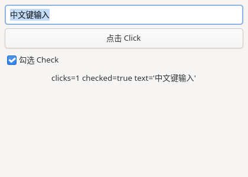

# dsh-ui-automation

Headless UI automation for [DeepSeek Harness](https://github.com/deepseek-ai): launch a GUI
application inside a private Xvfb shell and drive it like a user — click, double-click, drag,
scroll, type (CJK included), walk the accessibility tree, take screenshots — with a state
readback after **every** action.

> **This is an application sandbox, not a remote desktop.** Each `ui_launch` starts a brand-new
> instance in its own display, its own D-Bus session and its own `XDG_RUNTIME_DIR`. It cannot see
> or touch windows on the user's real desktop, and it does not inherit the user's login state.


## Why

An agent that can render a UI should be able to check that the UI actually works. This plugin
gives DSH a small, isolated lab for that:

- exercise a Qt/GTK app the way a user would, without a desktop session;
- assert on **application state**, not on "the click call returned 0";
- reproduce toolkit-specific problems (GTK4 async state, debounce windows, focus stealing) in a
  disposable shell;
- keep the capability opt-in per workspace, because launching and typing into arbitrary
  processes is a dangerous surface.

## What it is not

- Not VNC/RDP and not a browser-automation replacement.
- Not a secure sandbox: Xvfb has no authentication and the display is reachable by local
  processes. Never put real credentials inside it.
- Not a Wayland compositor: there is no GPU, no portal backend, and no input method daemon.

## Screenshots

| Qt 6 fixture | GTK 3 fixture | GTK 4 probe |
|---|---|---|
|  |  |  |

Each window shows its own counter line (`clicks=… dclicks=… drags=… wheel=… text='…'`). The
screenshots are the raw `ui_screenshot` output; the counters match the values read back over
AT-SPI during the run, which is the point: success is measured on the application, not on the
driver's return value.

## Install

### Requirements

| Dependency | Why |
|---|---|
| `Xvfb` | one virtual display per instance |
| `dbus` (`dbus-run-session`) | private session bus; AT-SPI lives on it |
| `at-spi2-core` | the accessibility registry the driver talks to |
| `python3` + `python-gobject` (`gi.repository.Atspi`) | the AT-SPI driver |
| `xdotool` | XTEST keyboard/mouse fallback |
| `ffmpeg` | `x11grab` screenshots |

On Arch: `pacman -S xvfb at-spi2-core xdotool ffmpeg python-gobject`.
On Debian/Ubuntu: `apt install xvfb dbus at-spi2-core xdotool ffmpeg python3-gi`.

### From GitHub

```bash
dsh plugin --profile web add github:__OWNER__/dsh-ui-automation
```

Restart DSH if the plugin does not appear immediately. The plugin row is called
`ui-automation`.

### From a local checkout

```bash
git clone https://github.com/__OWNER__/dsh-ui-automation.git
dsh plugin --profile web add ./dsh-ui-automation
```

Or use **Plugins → Add local directory** in the DSH UI. A local directory is a link install:
after editing the source, toggle `ui-automation` off/on in **Settings → Plugins** (or restart
DSH) so the Host reloads the module generation.

## Visibility

The `ui_*` tools are hidden from sessions by default. A session sees them only when its
workspace path is on the allow-list (`allowedWorkspacePaths`), its session id is listed in
`enabledSessionIds`, or `allowAllSessions` is on. With no configuration, the allow-list is the
plugin's own directory, so only sessions working on the plugin itself get the tools.

## Tools

Every action tool returns structured JSON (plus a human-readable render) with `ok`, `appId`,
`channel`, `target`, `elapsedMs`, `pacing` and an `effect` object. `effect.changed: false` means
"the call succeeded but no state change was observed" — re-inspect with `ui_tree` instead of
assuming success.

| Tool | Purpose | Key parameters |
|---|---|---|
| `ui_launch` | start an app in a fresh isolated shell | `command` (required array), `cwd`, `width`, `height`, `display`, `appName`, `runRoot` |
| `ui_click` | click a control | `appId` (required); `name`+`role`/`index`/`match` or `path`, or `x`/`y`; `via` (`auto`/`atspi`/`coordinate`), `action`, `button` |
| `ui_double_click` | double-click (XTEST, always) | `appId`; semantic or coordinate target; `intervalMs` 40–390 (default 120) |
| `ui_drag` | press → stepped move → release | `appId`; `fromName`/`fromPath` or `fromX`/`fromY`; same for `to…`; `steps` 1–120 (12), `stepMs` 1–200 (15), `durationMs`, `button` |
| `ui_scroll` | wheel at a target/point | `appId`; semantic target or `x`/`y`; `direction` (`up`/`down`/`left`/`right`), `amount` 1–50 (±120 per tick) |
| `ui_type` | text or key chords | `appId`; semantic target; `text` **or** `keys` (`ctrl+a`, `Return`, `shift+End`…); `mode` (`auto`/`atspi`/`keys`), `clearFirst` (default true), `delayMs`, `x`/`y` click-to-focus |
| `ui_tree` | dump the accessibility tree | `appId`; `maxDepth` 1–32 (10), `maxNodes` 1–2000 (400), `includeText` |
| `ui_screenshot` | capture the whole virtual screen | `appId`; `path` (file name or relative path) |
| `ui_close` | tear down one instance | `appId`; `keepLogs` |
| `ui_list` | list managed instances | — |

### Addressing

- **Semantic (preferred):** `name` with optional `role`, `index` (nth same-name match) and
  `match` (`exact`/`contains`/`regex`), or `path` from `ui_tree` (`"0/1/2"`).
- **Coordinates (fallback):** `x`/`y`; requires `allowCoordinateMode: true`. They only address
  the private display, never the user's desktop.

### Example

```text
ui_launch({ command: ["/usr/bin/kate"], width: 1280, height: 800 })
ui_tree({ appId: "ui-1-abcd", maxDepth: 6 })
ui_click({ appId: "ui-1-abcd", name: "Open", role: "push button" })
ui_type({ appId: "ui-1-abcd", name: "input", text: "你好，世界" })
ui_type({ appId: "ui-1-abcd", name: "input", keys: "ctrl+a" })
ui_screenshot({ appId: "ui-1-abcd" })
ui_close({ appId: "ui-1-abcd" })
```

## Configuration

Settings → Plugins → `ui-automation`. All fields are volatile: changes apply immediately, no
restart.

| Field | Default | Meaning |
|---|---|---|
| `displayRange` | `100-199` | inclusive range of X display numbers to allocate |
| `defaultWidth` / `defaultHeight` | `1024` / `768` | default virtual screen size (320–4096 / 240–4096) |
| `actionIntervalMs` | `150` | minimum gap between actions; Qt needs ≥120 ms |
| `gtk4ActionIntervalMs` | `300` | minimum gap for GTK4 apps; 150 ms still loses ~47% |
| `doubleClickIntervalMs` | `120` | gap between the two clicks (40–390) |
| `doubleClickGuardMs` | `600` | quiet window after a double-click; otherwise a second double-click inside the toolkit's multi-click window becomes a triple-click |
| `launchTimeoutMs` | `20000` | launch → appears in AT-SPI |
| `actionTimeoutMs` | `15000` | one driver request |
| `settleMs` | `80` | wait before the first readback |
| `readbackTimeoutMs` | `700` | readback polling limit (GTK4 applies state asynchronously) |
| `allowCoordinateMode` | `true` | allow `x`/`y` addressing |
| `maxInstances` | `3` | concurrent shells |
| `screenshotDir` | empty → `screenshots/` | screenshot directory, relative to the plugin |
| `enabledSessionIds` | empty | extra session ids (comma separated) |
| `allowedWorkspacePaths` | empty → plugin dir | workspace directories allowed to use the tools |
| `allowAllSessions` | `false` | expose the tools to every session (not recommended) |

## How it works

Each `ui_launch` creates:

1. a private `XDG_RUNTIME_DIR` (`mkdtemp`);
2. a private D-Bus session bus (`dbus-run-session`), with `org.a11y.Status.IsEnabled=true`;
3. an Xvfb display (`:N -screen 0 WxHx24`);
4. an AT-SPI driver speaking JSON-RPC over a Unix socket;
5. the application, in its own process group.

The toolkit is detected from `/proc/<pid>/maps` (`libQt6Core`, `libgtk-4`, `libgtk-3`,
`libelectron`) and used to pace actions. Every action is followed by a diff of the
accessibility tree (excluding volatile states such as `focused`), so the result reports
`effect.changed`, `changedNodes` and before/after samples.

Closing one instance — or the app exiting, the plugin unloading, or DSH exiting — terminates
the whole process group (`TERM` → 2 s grace → `KILL`), unmounts the private runtime directory
and removes it.

## Known pitfalls

These are measured behaviours, not guesses (see [VERIFY.md](VERIFY.md) for the raw numbers):

- **GTK4 reports fake `extents`**: `(0,0,w,h)` for every node. Semantic clicks that need a
  point fail with `E_NO_COORDS`; pass explicit `x`/`y`.
- **Debounce**: AT-SPI `Press` is dropped if sent too fast. Qt needs ≥120 ms (default 150),
  GTK4 ≥300 ms. The plugin paces per toolkit; do not bypass it by hammering the tools.
- **Double-click vs. triple-click**: the gap *between two double-clicks* matters more than the
  gap between the two clicks. Default `doubleClickGuardMs: 600`; at 300–350 ms GTK3 only
  registered half of them.
- **Focus without a window manager**: X focus is not assigned automatically. `ui_type` performs
  window focus → `grab_focus` → click-to-focus if needed → verification, and fails with
  `E_NO_FOCUS` rather than silently dropping keys.
- **GTK4 focus stealing**: after another widget takes focus, `grab_focus` can return false and
  `extents` cannot be trusted. Supply `x`/`y` on `ui_type` to click the field first.
- **Electron** exposes no `EditableText` by default (`--force-renderer-accessibility` helps);
  text input falls back to XTEST.
- **No input method**: fcitx5 is unavailable on the private bus, but `xdotool type` can send
  CJK keysyms directly in the X11 shell — the plugin uses that as the fallback.
- **No GPU / Wayland / portals**: 3D apps and portal-dependent dialogs degrade.
- **One screen, 1024×768 default**: multi-monitor and HiDPI scaling are untested.

Error codes are structured: `E_APP_EXITED` (with `logs.app`), `E_BAD_CWD`, `E_NO_NODE`,
`E_NO_INSTANCE`, `E_NO_COORDS`, `E_NO_FOCUS`, `E_READBACK`, `E_TOO_MANY`,
`E_SHELL_EXITED`, `E_NO_A11Y`.

## Testing

```bash
make -C test fixtures        # build the Qt 6 / GTK 3 control panels
node test/integration.mjs    # operations, isolation, failure paths, tool entry points
node test/reliability.mjs    # N attempts per operation (default 30), success rate + latency
```

The runners read the fixture's counter label after every call, so a PASS means the application
really changed. See [test/README.md](test/README.md) for optional research probes and
[VERIFY.md](VERIFY.md) for the recorded matrix (104/104 checks) and reliability run
(480 operations, 0 failures).

## Security

The tools launch and type into arbitrary local programs, so access is allow-listed per
workspace/session. The Xvfb display is **not** authenticated: this is an isolation boundary for
tests, not a security boundary. Do not put real credentials, tokens or production data in a
shell.

## Project layout

```
index.js              plugin entry, config schema, session gating, prompt section
lib/engine.js         instance lifecycle, actions, readback/diff, pacing
lib/tools.js          the ten ui_* tool definitions
lib/shell.js          spawning/tearing down the isolated shell
lib/driver.js         JSON-RPC client for the AT-SPI driver
lib/shipped.js        resolve Host-shipped peer dependencies
scripts/ui_shell.sh   per-instance Xvfb + D-Bus + app wrapper
scripts/atspi_driver.py  AT-SPI/XTEST driver
test/                 fixtures and real-machine test runners
```

## License

MIT © 2026 bot-for-imitoy. See [LICENSE](LICENSE).
