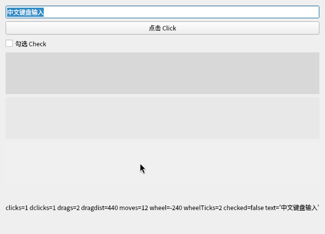

# dsh-ui-automation

在**隔离的无头 Xvfb 壳**里启动并操作 GUI 应用：点击、双击、拖拽、滚动、键盘输入（含中文）、
枚举无障碍树、截图。每次动作都会**回读应用状态**，`ok: true` 不等于“真的生效”。

> 这是应用沙盒 / 回归测试工具，**不是远程桌面**：沙盒里看不到也点不到用户真实桌面上的窗口，
> 也不继承用户的登录态。每次 `ui_launch` 都新建独立 display、私有 D-Bus 与私有
> `XDG_RUNTIME_DIR`。



## 安装

### 依赖

`Xvfb`、`dbus-run-session`（dbus）、`at-spi2-core`、`xdotool`、`ffmpeg`、
`python3` + `python-gobject`（`gi.repository.Atspi`）。

- Arch：`pacman -S xvfb at-spi2-core xdotool ffmpeg python-gobject`
- Debian/Ubuntu：`apt install xvfb dbus at-spi2-core xdotool ffmpeg python3-gi`

### 从 GitHub 安装

```bash
dsh plugin --profile web add github:__OWNER__/dsh-ui-automation
```

### 从本地目录安装

```bash
git clone https://github.com/__OWNER__/dsh-ui-automation.git
dsh plugin --profile web add ./dsh-ui-automation
```

或在 **插件 → 添加本地目录** 选择本目录。安装后插件行出现 `ui-automation`，工具即可用。
本地目录是链接安装：改完插件源码后，在 **设置 → 插件** 里把 `ui-automation` 关掉再打开
（或重启 DSH），新代码才会生效。

**可见范围**：默认只有工作区路径等于插件目录的会话能看到 `ui_*`。要换到别的会话：把那个
会话所在工作区的绝对路径填进 `allowedWorkspacePaths`，或直接把会话 ID 填进
`enabledSessionIds`（`allowAllSessions` 会向所有会话开放，不建议）。

## 工具

| 工具 | 作用 |
|---|---|
| `ui_launch` | 在新的隔离壳里启动应用，返回 `appId`、display、应用/窗口信息；失败附日志尾部 |
| `ui_click` | 语义（name/role/path）或坐标（x/y）点击，动作后回读 |
| `ui_double_click` | XTEST 双击，间隔默认 120ms（限制 40–390ms），回读 |
| `ui_drag` | 按下→分步 MOVE→松开（默认 12 步 × 15ms），结束校验指针到达终点 |
| `ui_scroll` | 滚轮 ±120/格（X11 按钮 4/5/6/7），回读 |
| `ui_type` | 文本优先 AT-SPI `EditableText`，否则 XTEST 键盘；支持 `ctrl+a` 等组合；自动取焦点并回读文本 |
| `ui_tree` | 枚举无障碍树（role/name/text/states/actions/rect），便于定位 |
| `ui_screenshot` | ffmpeg x11grab 截整个虚拟屏为 PNG |
| `ui_close` | 退出驱动并终止整个进程组（应用、Xvfb、私有总线），删除运行时目录 |
| `ui_list` | 列出托管实例 |

### 寻址

- **语义寻址（首选）**：`name` + 可选 `role` / `index` / `match`，或 `path`（`ui_tree` 返回的 `0/1/2`）。
- **坐标寻址**：`x`/`y`，只作兜底；需要配置 `allowCoordinateMode: true`。GTK4 的 extents 是
  `(0,0,w,h)` 假值，插件会明确报 `E_NO_COORDS`，此时改用显式 `x/y`。

### 回读与限速

- 每个动作后对整棵无障碍树做带摘要的对比（排除 `focused` 这类易变状态），返回
  `effect.changed` / `changedNodes` / `samples`。
- Qt 与 GTK4 都有 AT-SPI `Press` 去抖：Qt 需 ≥120ms、GTK4 需 ≥300ms；插件按检测到的工具包
  自动限速（默认 Qt/GTK3 150ms、GTK4 300ms）。
- GTK4 的点击是异步生效的，回读会轮询到 `readbackTimeoutMs`（默认 700ms）。
- 双击之后会等 `doubleClickGuardMs`（默认 600ms）：连续两次双击落在多击计数窗口内会被当成
  三击。实测 300–350ms 时 GTK3 只有一半生效，600ms 后 100%。
- 键盘输入前会依次尝试：窗口聚焦 → 控件 `grab_focus` → 必要时点击一次；最终确认 X 输入焦点
  在应用窗口上，否则报 `E_NO_FOCUS` 而不是静默丢键。

## 配置

设置 → 插件 → `ui-automation`（全部字段实时生效，无需重启）：

| 字段 | 默认 | 说明 |
|---|---|---|
| `displayRange` | `100-199` | 自动分配 display 号的区间 |
| `defaultWidth` / `defaultHeight` | 1024 / 768 | 虚拟屏幕尺寸 |
| `actionIntervalMs` | 150 | 通用动作间隔下限（Qt 需要 ≥120） |
| `gtk4ActionIntervalMs` | 300 | GTK4 动作间隔下限 |
| `doubleClickIntervalMs` | 120 | 双击间隔（40–390） |
| `doubleClickGuardMs` | 600 | 双击之后的静默窗口 |
| `launchTimeoutMs` | 20000 | 启动到进入 AT-SPI 的超时 |
| `actionTimeoutMs` | 15000 | 单次驱动请求超时 |
| `settleMs` | 80 | 动作后首次回读前等待 |
| `readbackTimeoutMs` | 700 | 回读轮询上限 |
| `allowCoordinateMode` | true | 是否允许坐标寻址 |
| `maxInstances` | 3 | 并发实例上限 |
| `screenshotDir` | 空 → `screenshots/` | 截图目录（相对插件目录） |
| `enabledSessionIds` | 空 | 额外放行的会话 ID，逗号分隔 |
| `allowedWorkspacePaths` | 空 → 插件目录 | 放行的工作区目录，逗号分隔 |
| `allowAllSessions` | false | 对所有会话开放（不建议） |

## 示例

```text
ui_launch({ command: ["/usr/bin/kate"], width: 1280, height: 800 })
ui_tree({ appId: "ui-1-abcd", maxDepth: 6 })
ui_click({ appId: "ui-1-abcd", name: "Open", role: "push button" })
ui_type({ appId: "ui-1-abcd", name: "input", text: "你好，世界" })
ui_type({ appId: "ui-1-abcd", name: "input", keys: "ctrl+a" })
ui_screenshot({ appId: "ui-1-abcd" })
ui_close({ appId: "ui-1-abcd" })
```

## 隔离模型

每次 `ui_launch` 都新建：

1. 私有 `XDG_RUNTIME_DIR`（`mkdtemp`）；
2. 私有 D-Bus session bus（`dbus-run-session`），并设置 `org.a11y.Status.IsEnabled=true`；
3. 独立 `Xvfb :N -screen 0 WxHx24`；
4. 独立 AT-SPI 驱动（Unix socket JSON-RPC）；
5. 被测应用（独立进程组）。

应用退出、`ui_close`、插件卸载或 DSH 进程退出时，整个进程组被终止、运行时目录被删除。
两个实例互不可见、可并行操作。

## 已知边界

- 看不到用户真实桌面窗口；操作的是**新启动的实例**，没有用户登录态/最近文件/剪贴板。
- 无 GPU；重 3D / 需要 Wayland 合成的应用不可用。私有总线上 portal 后端退化。
- 无输入法：fcitx5 在私有总线上不可用；但 XTEST `xdotool type` 在 X11 壳里可以直接输入中文。
- GTK4 的 extents 不可信；Electron 默认没有 `EditableText`（需 `--force-renderer-accessibility`）。
- Xvfb 默认无鉴权：这是**隔离沙盒，不是安全边界**，不要在里面放真实凭据。
- 只测单屏 1024×768，多屏/缩放未覆盖。

## 验证

真机验证矩阵、可靠性数据、安装后的真实工具调用与已知边界见 [VERIFY.md](VERIFY.md)。测试脚本在
`test/`，可直接重跑：

```bash
make -C test fixtures         # 编译 Qt6 / GTK3 测试面板
node test/integration.mjs     # 操作矩阵 + 隔离 + 失败路径 + 工具入口
node test/reliability.mjs     # 每类操作 30 次成功率/耗时
```

## 许可

MIT © 2026 bot-for-imitoy。见 [LICENSE](LICENSE)。
