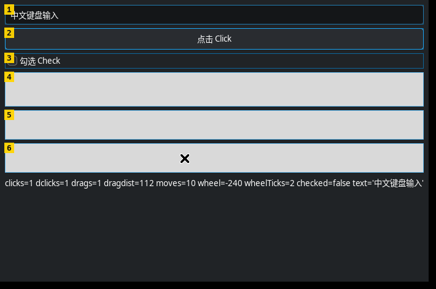
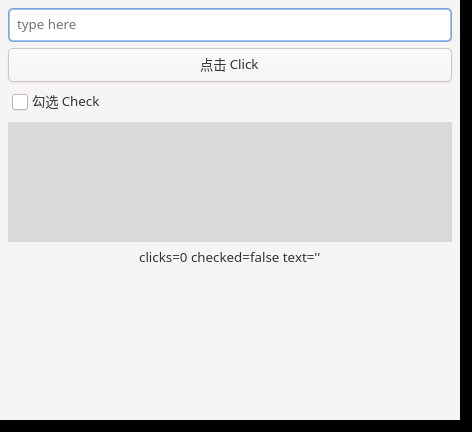

# dsh-ui-automation — 标号图片 UI 控制（DeepSeek Harness 插件）

**仅支持 Linux。** 插件通过 XTEST 操作 X11 display，通过 AT-SPI2 读取屏幕上的元素。不支持
macOS 与 Windows。

Agent 不再用名字、角色或坐标寻址。它拿到的是**标号截图**：每个可操作元素画一个黄色数字徽章
（`1..N`）和细边框，并有 sidecar JSON 记录编号 → 名字/角色/矩形。之后它只说“点 4”。每次操作都在
编号 4 的矩形中心做一次 XTEST 点击，等待 `afterSeconds`，**重新截一张标号图**并返回；上一张图的
编号在下一张图出现时就作废。


## 为什么用标号图片

- **只有一个契约**：“编号即像素”。没有语义树 API 与坐标兜底两套逻辑，也没有各工具包不同的
  action 名——点击永远是在编号矩形中心的一次 XTEST 点击。
- **可检查**：模型（或复核会话的人）可以 `read_image` 看到产生编号的那一帧；编号过期是可见的，
  不是隐藏状态。
- **可操作范围有界**：截图按窗口裁剪，编号有上限，旧图会被清理，索引空间不会无限增长。
- **无障碍信息少也能用**：过滤规则挑选可操作元素；树里没有的东西仍然出现在截图里。

## 它是什么 / 不是什么

- **是**屏幕级驱动：给一个 display（测试用 Xvfb，或真实桌面），按编号操作。
- **不是**启动器或沙盒：没有 `ui_launch`。应用由使用方启动，插件只接收 `display`。
- **不是**远程桌面协议：用的是本机 X server 与 AT-SPI。
- **不是** OCR：矩形和标签来自无障碍树；树里没有的文字会出现在图中，但不会被编号。

## 工具

| 工具 | 参数 | 返回 |
|---|---|---|
| `ui_screenshot` | — | `imagePath`、`imageId`、`display`、`screen`、`crop`、`targets[]` |
| `ui_click` | `index`、`button?`、`afterSeconds?` | 动作信息 + 下一张标号图 |
| `ui_double_click` | `index`、`intervalMs?`、`afterSeconds?` | 动作信息 + 下一张标号图 |
| `ui_scroll` | `index`、`direction`（up/down/left/right）、`amount?`、`afterSeconds?` | 动作信息 + 下一张标号图 |
| `ui_drag` | `fromIndex`、`toIndex`、`steps?`、`afterSeconds?` | 动作信息 + 下一张标号图 |
| `ui_type` | `text?` 或 `keys?`、`index?`、`afterSeconds?` | 输入/回读信息 + 下一张标号图 |

`index` 从 1 开始，只对最近一张标号图有效。越界返回结构化 `E_INDEX`；还没有截图就操作返回
`E_NO_IMAGE`。

`afterSeconds` 默认取插件设置（1.0 秒），范围 0–30；等待发生在**新截图之前**，所以晚重绘的应用
也能被拍到。

`ui_type` 给了 `index` 会先点一下该元素聚焦。文本优先走 AT-SPI
`EditableText.SetTextContents`（中文可靠）；节点没有 `EditableText` 时退回 XTEST 键入并回读校验。
`keys`（`ctrl+a`、`Return` 等）始终走 XTEST。

## 编号流程

1. `xdpyinfo` 取屏幕尺寸；
2. 遍历 session bus 上的每个 AT-SPI 应用；
3. 保留可交互角色/动作（以及有名字的拖拽区域），去掉布局容器、完全重复项、以及“包住其他候选”
   的区域；
4. 阅读顺序：按垂直中心分带，带内从左到右；
5. 按参与窗口的并集裁剪（加 `padding`），去掉黑桌面；
6. `ffmpeg -f x11grab` 抓裁剪区域，用 `drawtext`
   （`/usr/share/fonts/TTF/Hack-Bold.ttf`）画细边框 + 黄色徽章，不用 PIL、不用 Qt overlay；
7. 写 `<imageId>.png` 和 `<imageId>.json`（编号 → 角色/名字/矩形/中心/应用 pid/AT-SPI 路径，
   以及 screen/crop 元数据）。

如果所有目标报同一个 `(x, y)`（GTK 4.24 在 X11 上就是这样），截图会返回 `E_NO_GEOMETRY`，同时
仍写出裁剪后的证据图——坐标契约不能假装这些矩形可点。

## 截图

| Qt 6 fixture | GTK 3 fixture |
|---|---|
|  |  |

| GTK 4（无法取坐标） | WorkBuddy（Electron 真实应用） |
|---|---|
|  |  |

每张 fixture 图里都有它自己的计数行（`clicks=… dclicks=… drags=… wheel=… text='…'`），数值与
每次标号操作后通过 AT-SPI 回读的状态一致。GTK 4 对所有控件报 `(0,0,w,h)`，插件宁可不画徽章并
返回 `E_NO_GEOMETRY`，上面的 GTK4 图就是未编号的证据截图。

## 安装

### 依赖

| 依赖 | 用途 |
|---|---|
| 一个 X11 `DISPLAY` | 插件只操作你给的 display，不负责启动 |
| `at-spi2-core` | 编号助手读取的无障碍注册表 |
| `python3` + `python-gobject`（`gi.repository.Atspi`） | AT-SPI 枚举 |
| `xdotool` | XTEST 点击、拖拽、滚轮、键盘 |
| `ffmpeg` | `x11grab` 截图 + `drawtext` 徽章 |

Arch：`pacman -S at-spi2-core xdotool ffmpeg python-gobject`；
Debian/Ubuntu：`apt install at-spi2-core xdotool ffmpeg python3-gi`。
跑测试还需要 `xvfb`（`pacman -S xvfb` / `apt install xvfb`）。

### 从 GitHub 安装

```bash
dsh plugin --profile web add github:bot-for-imitoy/dsh-ui-automation
```

### 从本地目录安装

```bash
dsh plugin --profile web add /path/to/dsh-ui-automation
```

然后在插件设置里配置 `display`（留空则用 Host 的 `DISPLAY`）。

## 配置

| 字段 | 默认 | 含义 |
|---|---|---|
| `display` | 空 → `$DISPLAY` → `:0` | 目标 X display |
| `dbusAddress` | 空 → Host 环境 | AT-SPI 在私有总线时填写（测试/CI 用） |
| `screenshotDir` | 空 → `screenshots/` | PNG + sidecar JSON 目录 |
| `fontFile` | Hack-Bold.ttf | 徽章字体 |
| `maxDepth` | 24 | AT-SPI 遍历深度（Electron 需要 ≥24） |
| `maxTargets` | 60 | 单张图编号上限（1–200） |
| `padding` | 6 | 裁剪留白（像素） |
| `crop` | true | 按窗口并集裁剪（去掉黑桌面） |
| `afterSeconds` | 1.0 | 操作后重新截图前的等待（0–30） |
| `keepImages` | 15 | 保留最近多少组生成的图片（精选截图不受影响） |
| `attachImage` | true | Host 支持时同时把 PNG 作为 attachment/图片块返回（每次截图会存一份 attachment，介意存储可关闭） |
| `enabledSessionIds` | 空 | 额外放行的会话 ID |
| `allowedWorkspacePaths` | 空 → 插件目录 | 放行的工作区 |
| `allowAllSessions` | false | 对所有会话开放 |

## 可见范围与安全

插件可以操作**你配置的那个 display**——包括真实桌面。因此默认只对白名单会话/工作区开放（默认是
插件所在工作区），并给这些会话注入一段简短的使用提示。不要在没有明确需求时放开 `allowAllSessions`。

把它当成一台强力的本机输入设备，而不是沙盒：它不做进程隔离，点错编号就是真的点错。

## 图片返回

每个结果都带 `imagePath` 和文本索引清单。存在 `ctx.attachments` 服务且 `attachImage=true` 时，
PNG 还会经 `saveImage()` 保存并以 `image` content block 返回；如果模型路由是纯文本的，Host 会把
它替换成占位说明。这时（默认 DeepSeek 路由）模型需要看图时应该用 `read_image` 读取 `imagePath`。

## 已知边界

- **GTK 4.24（X11）** 对所有控件报 `(0,0,w,h)`，无法坐标编号，插件返回 `E_NO_GEOMETRY` 和裁剪后的
  证据图。
- **Electron** 必须带 `--force-renderer-accessibility`（WorkBuddy 截图即如此），否则树里几乎为空。
- 编号只在对应图片内有效；插件之外发生的状态变化需要重新 `ui_screenshot`。
- 很小的控件（单选按钮等）会编号，但点击目标仍然小；点击永远用记录的中心点。
- 不做 OCR：AT-SPI 看不到的元素会出现在截图里，但不会编号。
- 不原生支持 Wayland；XWayland 只按它暴露的 X11 能力工作。
- 仅 Linux。

## 测试

```bash
make -C test fixtures          # 编译 Qt6 / GTK3 / GTK4 面板
node test/integration.mjs      # 67 项断言，自己起 Xvfb + 私有 D-Bus + fixture
node test/reliability.mjs      # 每类操作 30 次
node test/capture-screenshots.mjs
```

测试自己拥有 Xvfb、私有总线和 fixture；插件只拿到 display（和总线地址）。所有断言都回读 fixture
自己的计数标签。具体数字见 [VERIFY.md](VERIFY.md)。

## 目录结构

```
index.js                 插件入口：设置、会话白名单、提示词
lib/automation.js        最近图片状态、截图编排、动作
lib/tools.js             6 个工具定义 + 人类可读渲染
lib/x11.js               xdotool/XTEST 封装
lib/shipped.js           从 DSH 安装目录解析 dsh-tools/schemastery
scripts/numbering.py     AT-SPI 枚举、编号、裁剪、徽章、sidecar JSON
test/                    fixtures + 集成/可靠性/截图脚本
screenshots/             文档引用的精选标号图
```

## 许可

MIT，仅 Linux。
