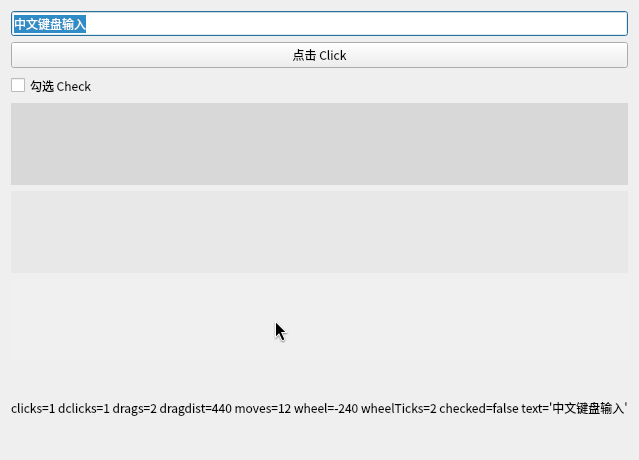

# 验证记录（真机）

> 验证时间：2026-11-24
> 环境：Arch Linux / Xvfb 21.1.26 / at-spi2-core 2.62.1 / Qt 6.12.0 / GTK 3.24.52 / GTK 4.24.1 / xdotool 4.0 / ffmpeg / Node v26.13.1
> 所有数字都来自本机实际运行，不是文档推断。驱动脚本：`test/integration.mjs`、`test/reliability.mjs`（源码在本目录，可重跑）。

## 被测对象

| 目标 | 工具包 | 用途 |
|---|---|---|
| `test/fixtures/panel_qt` | Qt 6 | 自建面板：按钮/复选框/输入框 + **双击、拖拽、滚轮计数器** |
| `test/fixtures/panel_gtk3` | GTK 3 | 同一套控件的 GTK3 版本 |
| `probe/app_qt` | Qt 6 | 前序调研探针（只读复用，未改动） |
| `probe/app_gtk3` | GTK 3 | 同上 |
| `probe/app_gtk4` | GTK 4 | 同上；专门覆盖 GTK4 的 extents/去抖/焦点问题 |

测试做的事：用插件真实的 `UiEngine` 和 `createTools()` 定义执行操作，**每次操作后读应用自己的状态标签**（`clicks=… dclicks=… drags=… wheel=… text=…`），而不是信任 `do_action()` 的返回值或日志。

## 1. 操作矩阵：104/104 通过

`node test/integration.mjs`（覆盖 5 个应用、语义/坐标两条通道、控制台工具入口、隔离与失败路径）。其中 `app_qt / app_gtk3 / app_gtk4` 是当时的调研探针，不在本仓库内；重跑前把 `XVFB_PROBE_DIR` 指向它们所在目录，否则这三个应用会被跳过（只跑仓库内 fixture 时是 56 项）：

```
== Qt6 fixture ==
  [PASS] Qt6 fixture 启动 (556 ms) — ui-1-gena @ :104 556ms，toolkit=qt6
  [PASS] AT-SPI 语义点击 button (128 ms) — channel=atspi 0 → 1
  [PASS] 坐标点击 button (229 ms) — (265,55) 1 → 2
  [PASS] 双击 dblarea (359 ms) — dclicks 0 → 1，间隔 2 次点击
  [PASS] 拖拽 dragarea（12 步 × 15ms） (347 ms) — drags 0 → 1，dist=468，指针={"x":499,"y":144}
  [PASS] 滚轮向下 ×2（-240） (155 ms) — wheelTicks 0 → 2，wheel=-240
  [PASS] 输入ASCII (38 ms) — channel=atspi-set-text 回读="hello world"
  [PASS] 输入中文（AT-SPI SetTextContents） (123 ms) — 回读="你好世界"
  [PASS] 输入中文（XTEST 键盘兜底） (396 ms) — channel=xtest 回读="中文键输入"
  [PASS] 按键组合 ctrl+a (180 ms) — focus steps=grab_focus
  [PASS] 截图 (195 ms) — …/ui-1-gena-….png（17362 字节，1024x768）
  [PASS] 不存在的目标返回结构化错误 — E_NO_NODE
  [PASS] ui_close 回收实例 — forced=false, 9ms

== GTK4 research probe ==
  [PASS] AT-SPI 语义点击 button (300 ms) — channel=atspi 0 → 1        ← 300ms 限速
  [PASS] GTK4 无 Action + 假坐标时明确报错 (20 ms) — E_NO_COORDS
  [PASS] GTK4 显式坐标点击复选框 (237 ms) — checked false → true     ← 坐标兜底
  [PASS] 输入中文（AT-SPI SetTextContents） — 回读="你好世界"
  [PASS] 输入中文（XTEST 键盘兜底） — channel=xtest 回读="中文键输入"

== 并行隔离（两个壳互不可见） ==
  [PASS] 并行启动两个壳 — ui-6-7hmv @ :102 / ui-7-lxcb @ :103
  [PASS] 实例 A 只看到自己的应用 — A=panel_qt B=app_gtk3
  [PASS] 两个实例可并行操作 — A.clicks=1 B.clicks=1

== 启动失败与超时处理 ==
  [PASS] 应用立即退出 → E_APP_EXITED（约 0.4s，带 app 日志 "boom"）
  [PASS] 不存在的可执行文件 → E_APP_EXITED
  [PASS] 不存在的工作目录 → E_BAD_CWD

== 工具定义（defineTool → execute → render） ==
  [PASS] 注册 10 个工具 — ui_launch, ui_click, ui_double_click, ui_drag, ui_scroll, ui_type, ui_tree, ui_screenshot, ui_close, ui_list
  [PASS] ui_launch / ui_click / ui_list / ui_close 通过工具入口工作
  [PASS] ui_click 渲染包含回读结论
  [PASS] 未知 appId → 结构化错误

integration matrix: 104/104 passed
```

## 2. 可靠性：每类操作 30 次

`node test/reliability.mjs`（应用内计数器逐次断言；每次调用都计入端到端耗时，含限速与回读）：

| app | toolkit | operation | success | rate | mean | p50 | p95 | max |
|---|---|---|---|---|---|---|---|---|
| panel_qt | qt6 | click | 30/30 | 100.0% | 117ms | 117ms | 124ms | 128ms |
| panel_qt | qt6 | type | 30/30 | 100.0% | 133ms | 136ms | 139ms | 140ms |
| panel_qt | qt6 | double_click | 30/30 | 100.0% | 770ms | 785ms | 798ms | 800ms |
| panel_qt | qt6 | drag | 30/30 | 100.0% | 355ms | 336ms | 377ms | 863ms |
| panel_qt | qt6 | scroll | 30/30 | 100.0% | 134ms | 134ms | 148ms | 165ms |
| panel_gtk3 | gtk3 | click | 30/30 | 100.0% | 131ms | 131ms | 137ms | 143ms |
| panel_gtk3 | gtk3 | type | 30/30 | 100.0% | 141ms | 143ms | 145ms | 146ms |
| panel_gtk3 | gtk3 | double_click | 30/30 | 100.0% | 779ms | 794ms | 799ms | 801ms |
| panel_gtk3 | gtk3 | drag | 30/30 | 100.0% | 327ms | 308ms | 316ms | 877ms |
| panel_gtk3 | gtk3 | scroll | 30/30 | 100.0% | 129ms | 129ms | 134ms | 136ms |
| app_qt | qt6 | click | 30/30 | 100.0% | 144ms | 142ms | 163ms | 183ms |
| app_qt | qt6 | type | 30/30 | 100.0% | 117ms | 121ms | 132ms | 132ms |
| app_gtk3 | gtk3 | click | 30/30 | 100.0% | 129ms | 130ms | 137ms | 146ms |
| app_gtk3 | gtk3 | type | 30/30 | 100.0% | 142ms | 144ms | 146ms | 148ms |
| app_gtk4 | gtk4 | click | 30/30 | 100.0% | 291ms | 288ms | 312ms | 350ms |
| app_gtk4 | gtk4 | type | 30/30 | 100.0% | 272ms | 280ms | 288ms | 288ms |

- 16 组 × 30 次 = 480 次操作，0 失败；总墙钟 141s。
- 双击的 mean ≈780ms 包含**刻意的 600ms 多击静默窗口**（见 §3.4），不是操作本身慢。
- 拖拽的 max ≈870ms 是其中一次回读等到了轮询上限（拖拽后状态刷新慢于 `settleMs`），但仍成功。
- 类型测试按 `ascii-N` / `中文-N` 交替，全部经 `SetTextContents` 并逐次回读校验。

## 3. 实测发现（都写进了实现）

### 3.1 只调用 AT-SPI 成功不够：GTK4 的状态是异步到达的
首次 GTK4 点击在 `do_action` 返回后 80ms 回读仍显示 `clicks=0`，但稍后再读已变成 `clicks=1`。单次采样会产生**假阴性**；改为 `settleMs`（80ms）后按 60ms 轮询到 `readbackTimeoutMs`（700ms），GTK4 点击稳定通过。

### 3.2 无 WM 时的键盘焦点 + GTK4 的 grab_focus
- 没有窗口管理器时 X 焦点不会自动分配，必须先 `windowfocus`；`ui_type` 自动化了窗口聚焦 → `grab_focus` → 必要时点击聚焦 → 再次校验的顺序。
- **GTK4 在别的控件持有焦点后 `grab_focus` 不生效**（返回 false），而且它的 extents 全是 `(0,0,w,h)` 假坐标，没法自动算点击点。因此 `ui_type` 支持可选的 `x`/`y` 作为“点击聚焦点”；实测在复选框抢走焦点后，用 `ui_type({name:"input", x:200, y:17})` 能重新聚焦并成功输入，否则会明确报 `E_NO_FOCUS`。

### 3.3 GTK4 的假坐标
`ui_click({name:"check"})` 对 GTK4 的 check box 报：

```
E_NO_COORDS: 节点 "check" 的屏幕坐标不可用（extents=0,0）。
GTK4 常报告 (0,0,w,h) 的假坐标；请显式传 x/y。
```

显式 `ui_click({x:60, y:100})` 则成功把 `checked` 从 false 翻成 true。

### 3.4 双击：不是“间隔”问题，是“多击计数窗口”问题
- 第一版用 `xdotool click --repeat 2 --delay 120`，实测两次点击总间隔约 **245ms**，GTK3 只有 **50%** 生效（卡在 GTK 的 250ms 双击阈值上）。
- 改成一次 xdotool 调用内 `mousedown/mouseup/sleep/mousedown/mouseup`，点击间隔精确为 120ms。
- 但 GTK3 仍只有 **50%**：把操作间隔从 350ms 拉到 600ms 后变成 **100%**。原因不是两次点击的间隔，而是**连续两次双击之间的间隔**落在多击计数窗口内，第二轮被 GTK 当成三击（`GDK_3BUTTON_PRESS`），不产生双击事件。扫描数据：操作间隔 300ms → 3/6，600/1000/1600ms → 6/6。
- 实现：`doubleClickGuardMs`（默认 600ms），双击后所有动作都会等这个静默窗口。之后 Qt/GTK3 的双击都是 30/30。

### 3.5 工具包去抖（与前序调研一致，插件已内建）
- Qt：连点 AT-SPI `Press` 需 ≥120ms；插件默认 150ms。
- GTK4：需 ≥300ms；插件默认 300ms。
- GTK3：无去抖，仍按 150ms 统一限速。
- 工具包从 `/proc/<pid>/maps` 判断（`libQt6Core` / `libgtk-4` / `libgtk-3` / `libelectron`），不依赖 AT-SPI 元数据。

### 3.6 驱动的退出不能只发 SIGTERM
应用退出时，驱动可能正卡在 libatspi 的 D-Bus 调用里，信号处理器要等 C 调用返回才运行；只发 SIGTERM 会让整个壳（含 Xvfb）挂住，还会触发 at-spi registry 的激活风暴。现在 `ui_shell.sh` 的 cleanup 是 **TERM → 2s 宽限 → KILL**，并且 Node 侧独立检测应用 pid 退出：应用秒退时 ~0.4s 返回 `E_APP_EXITED`（附 app 日志），不再等满 20s。

## 4. 隔离、清理与失败路径

- 两个实例同时运行：`:102` / `:103`，各自只看到自己的应用，点击互不影响；关闭后实例表清零。
- `ui_close` 会终止整个进程组，删除 `runDir`（gvfs 的 fuse 挂载可能晚几百毫秒卸载，删除有重试）。
- 失败路径均返回结构化 JSON：`E_APP_EXITED`（带 `logs.app`）、`E_BAD_CWD`、`E_NO_NODE`、`E_NO_INSTANCE`、`E_NO_COORDS`、`E_NO_FOCUS`、`E_READBACK`、`E_TOO_MANY`。
- 读回为“没有变化”时仍返回 `ok: true`，但带 `warnings` 和 `effect.changed: false`，不伪装成功。

## 5. 已知边界（真机验证中确认）

| 边界 | 现象 |
|---|---|
| 看不到用户真实桌面 | 私有总线上只有自己启动的应用；这是沙盒，不是远程桌面 |
| GTK4 坐标 | extents 恒为 `(0,0,w,h)`；必须显式 x/y |
| Electron | 默认无 `EditableText`，需 `--force-renderer-accessibility`；文本走 XTEST |
| 输入法 | 私有总线上没有 fcitx5；但 `xdotool type` 可直接送中文 keysym（已验证） |
| GPU / Wayland-only / portal | 无 GPU、无 Wayland 合成器；portal 后端在私有总线上退化 |
| 安全 | Xvfb 无鉴权，本机任意进程可接入——**不要把它当安全边界** |
| 截图 | 用 `ffmpeg -f x11grab`（等价于 XGetImage 的全屏抓帧），非字面意义的 XGetImage |
| 多屏/缩放 | 只测单屏 1024x768 |

## 6. 复现

```bash
cd /path/to/dsh-ui-automation
make -C test fixtures                # 编译自建 Qt6 / GTK3 面板
node test/integration.mjs            # 56 项（仓库内 fixture）；设 XVFB_PROBE_DIR 后 105 项
node test/reliability.mjs            # 480 次操作（约 141s；探针缺失时只跑 fixture）
```

原始输出：`test/out/integration.log`、`test/out/reliability.log`、`test/out/reliability.json`；截图：`test/out/screenshots/`。

## 7. 安装进 profile 后的真实会话验证（工具入口）

`plugin_manager install_bundle` 结果：`application: applied`，`warnings: []`，插件行 `ui-automation` 为 active。工具默认只对插件所在工作区的会话可见（本验证会话即如此），因此下面是在**真实 Host 注册之后**、通过 `ui_*` 工具schema 执行的调用，而不是直接调 engine：

```
ui_launch  {"command":[".../test/fixtures/panel_qt"]}
  ✓ ui-1-1v8s @ :100（1024x768），Qt6，启动 531ms，限速 150ms

ui_click   {"appId":"ui-1-1v8s","name":"button"}
  ✓ 通道=atspi，回读状态已变化（按钮 pressed 状态 + 状态标签）

ui_double_click {"name":"dblarea"}
  ✓ dclicks 0 → 1（回读标签）

ui_drag    {"fromX":40,"fromY":144,"toX":480,"toY":144,"steps":12}
  ✓ drags 1 → 2，dragdist=440，moves=12

ui_scroll  {"name":"wheelarea","direction":"down","amount":2}
  ✓ wheelTicks 0 → 2，wheel=-240

ui_type    {"name":"input","text":"你好，DSH"}
  ✓ 通道=atspi-set-text，回读="你好，DSH"（已校验）

ui_type    {"name":"input","text":"中文键盘输入","mode":"keys"}
  ✓ 通道=xtest，回读="中文键盘输入"，焦点处理 grab_focus，372ms

ui_type    {"name":"input","keys":"ctrl+a"}
  ✓ 通道=xtest-key，178ms

ui_screenshot → screenshots/ui-1-1v8s-….png（1024x768，17830 字节）
ui_close ×2 → ui_list 显示“没有托管的 UI 实例”，且 /tmp 无残留、无 Xvfb、无 fuse 挂载
```

截图（可直接看到计数器与中文文本都和回读一致）：



GTK4 也在同一会话里验证过：

```
ui_launch  [".../probe/app_gtk4"] → 限速 300ms
ui_click   {"name":"点击 Click"} → 回读 clicks=0 → 1（323ms，含 300ms 限速）
ui_click   {"x":60,"y":100}      → checked false → true（坐标兜底；GTK4 的 extents 不可用）
ui_type    {"name":"input","text":"沙盒里的中文输入"} → 回读一致
```

**这次安装验证抓到并修掉了一个只在 Host 侧才暴露的缺陷**：engine 结果里带 `undefined` 字段时，工具 schema 的 lossless-JSON 校验会拒绝整个结果（`tool "ui_click" returned invalid output`），而直接调用 `execute()` 的测试不会触发。现在所有工具输出都经过 `jsonSafe()` 归一化（丢 `undefined`、非有限数字），重新加载模块代际后通过。

> 模块代际重载：本地链接安装的插件修改源码后，`install_bundle` 会报 `already-installed`；需要在设置→插件里把 `ui-automation` 关掉再打开（本验证即如此），或重启 DSH。
